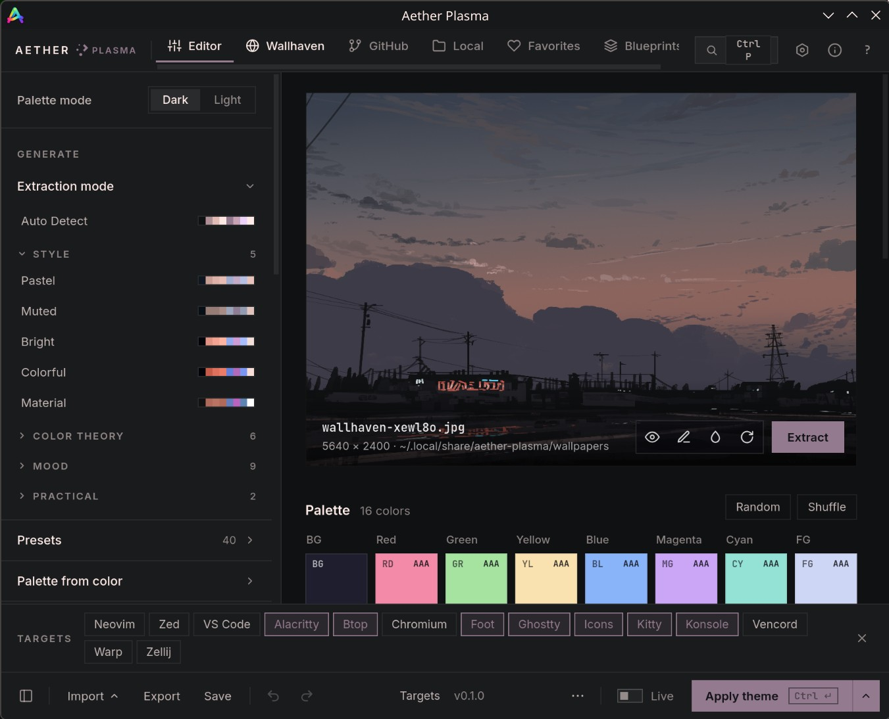

<p align="center">
  
</p>

# Aether Plasma

**Theme KDE Plasma from your wallpaper.** Pick an image, Aether extracts a 16-color palette, you tweak it, press Apply, and your whole desktop follows in a second: Plasma's colors, the wallpaper, the lock screen, Konsole, Ghostty and your other terminals. No logout, no restarting apps.



[Aether](https://github.com/omacom/aether) by Bjarne Øverli is the best wallpaper-to-theme tool on Linux, but it is built for [Omarchy](https://omarchy.org) (Hyprland). On any other desktop it writes theme files and stops there. Aether Plasma is a fork that finishes the job on **KDE Plasma 6**: it generates a native KDE color scheme, activates it, and wires the terminals in, as a layer on top of your own configs. Built and used daily on CachyOS (Plasma 6, Wayland).

## What Apply does on Plasma

| Target | How | Always / toggle |
|---|---|---|
| Plasma color scheme | Generates `Aether Plasma` (`~/.local/share/color-schemes/AetherPlasmaA/B.colors`) and activates it with `plasma-apply-colorscheme`. GTK apps follow through Plasma's own GTK sync. | Always |
| Wallpaper | `plasma-apply-wallpaperimage` (all desktops) | Always |
| Lock screen | Same image in `kscreenlockerrc` | Always |
| Icons | Switches to the selected icon theme with `plasma-changeicons`, only if it is installed | On, can be turned off |
| Konsole | `AetherPlasma.colorscheme` set on the default profile (creates an `Aether Plasma` profile if there is none) | On, can be turned off |
| Ghostty | Managed `config-file` include, live reload via SIGUSR2 | On, can be turned off |
| Alacritty | Managed `general.import`, live reload | On, can be turned off |
| Kitty | Managed `include`, reload via SIGUSR1 | On, can be turned off |
| Foot | Managed `include=` | On, can be turned off |
| btop | `~/.config/btop/themes/aether-plasma.theme` + `color_theme`, reload via SIGUSR2 | On, can be turned off |
| VS Code, Zed, Neovim | Upstream Aether integrations | Opt-in |

Toggles live in the **Targets** strip at the bottom of the window. Apps that are not installed are skipped. Hyprland-only targets (Hyprland, Hyprlock, Waybar, Walker, Mako, SwayOSD, Wofi) are hidden in the UI.

**Layered, not invasive.** Aether Plasma only writes its own files plus a marked block in app configs:

```
# >>> aether-plasma (managed block, do not edit) >>>
config-file = ?"/home/you/.config/aether-plasma/theme/ghostty.conf"
# <<< aether-plasma <<<
```

The first time it changes one of your files it keeps a copy next to it (`<file>.before-aether-plasma`). Delete the block to opt out. **Clear theme** restores the color scheme you had before.

It uses its own folders (`~/.config/aether-plasma`, `~/.cache/aether-plasma`, `~/.local/share/aether-plasma`) and binary (`aether-plasma`), so it can sit next to stock Aether.

Set `AETHER_PLASMA=0` to disable Plasma activation (files are still generated) or `AETHER_PLASMA=1` to force it outside a detected Plasma session.

## Install (from source, user-local)

```bash
sudo pacman -S --needed go webkit2gtk-4.1 nodejs npm
go install github.com/wailsapp/wails/v2/cmd/wails@v2.16.0
git clone https://github.com/davidboulay/aether-plasma.git
cd aether-plasma && make install   # → ~/.local/bin/aether-plasma + app launcher entry
```

`make install` also installs the **Aether Plasma** wallpaper plugin and switches your desktops to it, keeping the current image. It adds **Open Aether Plasma** (and **Open Wallpaper Image**) to the desktop right-click menu. Plasma has no other way for an app to add an item there. Aether Plasma then sets wallpapers through the plugin. To go back to Plasma's Image wallpaper, run `contrib/plasma-wallpaper/activate.sh off` or pick *Image* in *Desktop and Wallpaper*. Aether then falls back to it on its own. The plugin has no slideshow.

`make update` pulls and reinstalls; `make uninstall` removes it.

## CLI

```bash
aether-plasma --generate ~/Pictures/wall.jpg            # extract + apply to Plasma
aether-plasma --generate ~/Pictures/wall.jpg --light-mode
aether-plasma --generate ~/Pictures/wall.jpg --no-apply --output /tmp/theme
```

## Roadmap

**Done (0.2, 2026-11-03)**
- **Open Aether Plasma** from the desktop right-click menu (own wallpaper plugin, installed and activated by `make install`)

**Done (0.1, 2026-11-01)**
- Native KDE color scheme generated from the palette, light and dark, activated live
- Desktop + lock screen wallpaper, icon theme
- Konsole, Ghostty, Alacritty, Kitty, Foot and btop, on by default, reloaded live where the app supports it
- Own folders and binary, so it installs next to stock Aether; Hyprland-only targets hidden

**Next**
- **Packaging**: an AUR package (`aether-plasma-bin`) and prebuilt binaries on GitHub Releases, so installing doesn't need Go and Wails
- **Running Konsole windows**: recolor open sessions over D-Bus instead of only new ones
- **Accent color**: set Plasma's accent from the palette so it also reaches Breeze widgets that ignore the scheme's selection color
- **Firefox and Chromium**: a theme that follows the palette without root-only browser policies
- **Kvantum**: generate a matching Kvantum theme for people who use it instead of Breeze
- **Plasma 6 day/night**: let Plasma's automatic light/dark switch pick the light or dark variant of the current theme

**Later**
- SDDM login screen (needs root, so an opt-in helper)
- Per-screen wallpapers
- Its own icon

**Staying close to upstream**: Aether Plasma tracks [omacom/aether](https://github.com/omacom/aether) and merges new releases, so palette, editor and wallpaper improvements land here too. Plasma code stays in `internal/plasma` and two templates to keep merges small.

## Credits

All the palette, editor and wallpaper work is upstream Aether (MIT). This fork adds the Plasma backend (`internal/plasma`), the `kde.colors` and `konsole.colorscheme` templates, and the renaming.

---

The upstream README follows.

# Aether

A visual theming application for [Omarchy](https://omarchy.org). Extract colors from wallpapers and apply cohesive themes across your entire desktop.

> **Not using Omarchy?** Aether works standalone on any Linux desktop. See the [Standalone Guide](docs/standalone.md) for setup.

## Features

### Color Extraction
- Pure Go median-cut algorithm that generates a full 16-color ANSI palette from any wallpaper
- 8 extraction modes: Normal, Monochromatic, Analogous, Pastel, Material, Colorful, Muted, and Bright
- 12 fine-tuning sliders (vibrance, contrast, temperature, shadows, highlights, and more)
- Light and dark mode toggle with automatic color anchor swapping

### Wallpaper Tools
- Search and download wallpapers from wallhaven.cc directly in the app
- Browse public GitHub repositories for wallpapers
- Export favorite wallpapers as a ZIP archive with source metadata
- Apply a blurred wallpaper variant while extraction uses the original image
- Full wallpaper editor with blur, exposure, sharpen, vignette, grain, and color toning
- 12 one-click image presets: Cinematic, Vintage, Film, Dramatic, and more

### Theme Library
- 24 built-in color presets including Dracula, Nord, Gruvbox, Catppuccin, and Sakura
- Import 250+ community Base16 color schemes
- Save and restore complete themes as blueprint files
- Export themes as shareable packages with selective app inclusion
- Keep the palette-matched Yaru icon default or choose an installed desktop icon theme per blueprint

### Application Support
- 20+ pre-configured apps: Hyprland, Waybar, Kitty, Alacritty, Ghostty, Neovim, VS Code, Zed, btop, and more
- Template system with hex, RGB, RGBA, and stripped format modifiers
- Per-app overrides, reload hooks, and post-apply scripts
- Add your own apps with custom templates

### Extras
- WCAG contrast ratio checker with AAA/AA accessibility grading
- Gradient generator and single-color palette builder
- 50-step undo/redo history
- Headless CLI for scripting, keybinds, and automation

## Quick Start

### Install (Arch Linux)

```bash
yay -S aether
```

### Install (Debian / Ubuntu)

Download the `.deb` from the [latest release](https://github.com/omacom/aether/releases/latest):

```bash
sudo dpkg -i aether_*.deb
sudo apt-get install -f
```

### Build from Source

```bash
# Arch
sudo pacman -S go webkit2gtk

# Debian/Ubuntu
sudo apt install golang libgtk-3-dev libwebkit2gtk-4.1-dev

git clone https://github.com/omacom/aether.git
cd aether && make build
```

### Package-managed installs

When pacman owns the `aether` binary, Aether does not check for releases or upgrade itself. `aether upgrade` prints the update command instead: `omarchy-update`, `yay -Syu`, `paru -Syu` or `sudo pacman -Syu`.

To set this behavior in other packages, give the update command at build time:

```bash
wails build -tags webkit2_41 -ldflags "-X 'aether/internal/update.packageUpdateCommand=sudo dnf upgrade aether'"
```

### Basic Usage

1. Select a wallpaper (drag & drop, file picker, or wallhaven browser)
2. Click **Extract** to generate a color palette
3. Adjust colors as needed
4. Click **Apply Theme**

### Desktop Icon Themes

Use the compact **Icons** control directly above **Accessibility** in the editor sidebar. Its switch enables or disables the existing Icons target, while the selection opens the installed-theme chooser. **Automatic** preserves Aether's color-matched Yaru output. An explicit choice writes the installed theme's directory ID; if that theme is later uninstalled, Aether keeps the saved ID and marks it as missing instead of silently replacing it. Disabling Icons omits `icons.theme` without erasing the choice.

The picker searches the standard user and system XDG icon roots and the legacy `~/.icons` root. **Refresh** rescans after you install a theme. Aether does not download or install icon themes.

## CLI

```bash
aether --generate ~/wallpaper.jpg
aether --apply-blueprint "My Theme"
aether --list-blueprints
```

See `aether --help` for all options.

## Local Development

```bash
git clone https://github.com/omacom/aether.git
cd aether

# Install frontend dependencies
cd frontend && npm install && cd ..

# Run in development mode (hot reload)
wails dev

# Build production binary
wails build
```

**Prerequisites:** Go 1.25+, Node.js 22.22.2+ or 24.15+ LTS, [Wails v2](https://wails.io), webkit2gtk, gtk-layer-shell, gstreamer, gst-plugins-good

### Verification

Run `make test` for the Go package tests. With the native build dependencies installed, `go test -race -tags webkit2_41 ./...` also covers the app entry points and enables Go's race detector (omit the tag on WebKitGTK 4.0 systems).

From `frontend/`, run `npm ci`, `npm run check`, `npm test`, and `npm run build`. The frontend regression suite uses mocked Wails calls, so it does not change your desktop. Use `make dev` for manual verification of native dialogs, rendering, and theme application.

## Documentation

| Guide | Description |
|-------|-------------|
| [Installation](docs/installation.md) | Detailed setup instructions |
| [CLI Reference](docs/cli.md) | Command-line options |
| [Color Extraction](docs/color-extraction.md) | How the algorithm works |
| [Base16 Schemes](docs/base16.md) | Import community color schemes |
| [Wallpaper Editor](docs/wallpaper-editor.md) | Image filters and presets |
| [Wallhaven](docs/wallhaven.md) | Browse online wallpapers |
| [GitHub Source](docs/github-source.md) | Browse repository wallpapers |
| [Favorites](docs/favorites.md) | Save wallpapers and export a collection |
| [Blueprints](docs/blueprints.md) | Save and restore themes |
| [Custom Templates](docs/custom-templates.md) | Add support for your apps |
| [Custom Apps](docs/custom-apps.md) | Per-app template system |
| [File System](docs/filesystem.md) | Where Aether stores files |
| [Remote Control](docs/remote-control.md) | IPC commands and AI integration |
| [Protocol Handler](docs/protocol-handler.md) | Register `aether://` links |
| [Omarchy Shell Plugins](docs/quickshell.md) | Native wallpaper and blueprint selectors |
| [Standalone](docs/standalone.md) | Using Aether without Omarchy |
| [Troubleshooting](docs/troubleshooting.md) | Common issues |

## Complementary Projects

- [omarchy-theme-hook](https://github.com/OldJobobo/thpm) - A clean solution to extend your Omarchy theme to other apps.
- [waybar-themes](https://github.com/HANCORE-linux/waybar-themes) - Waybar themes by HANCORE.

## Contributing

See [CLAUDE.md](CLAUDE.md) for architecture details.

## License

MIT - Created by [Bjarne Overli](https://x.com/iamdothash)
